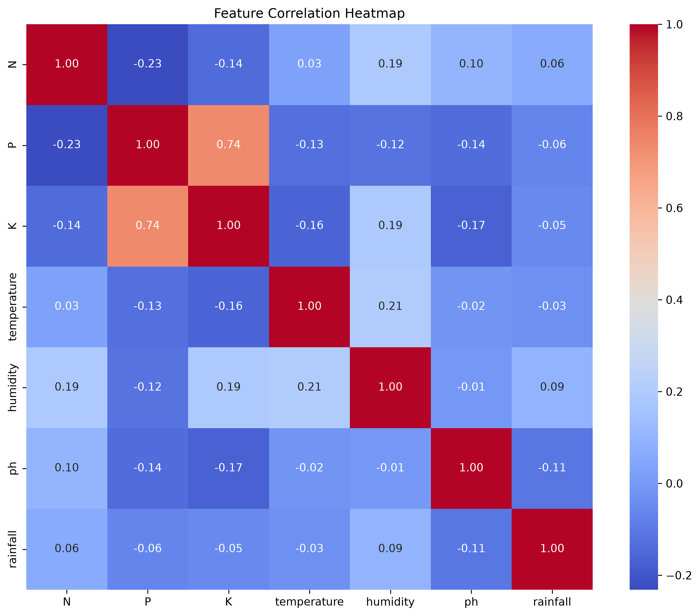
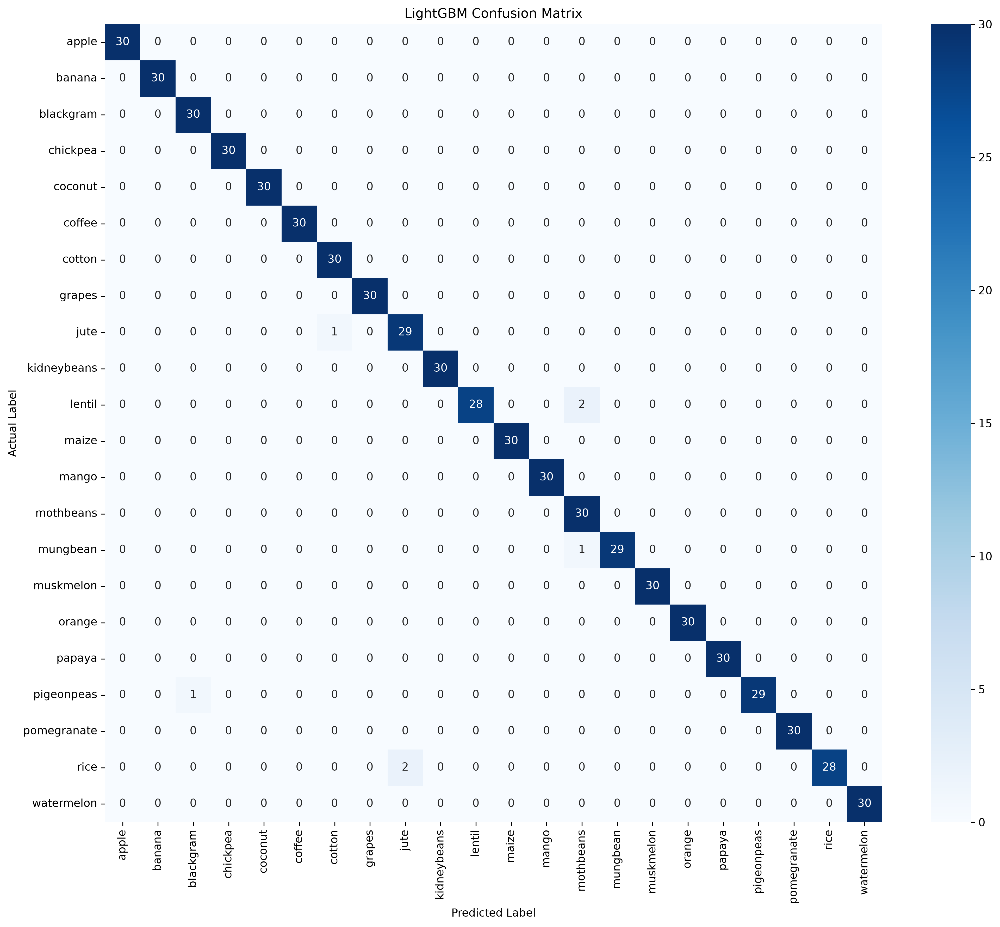
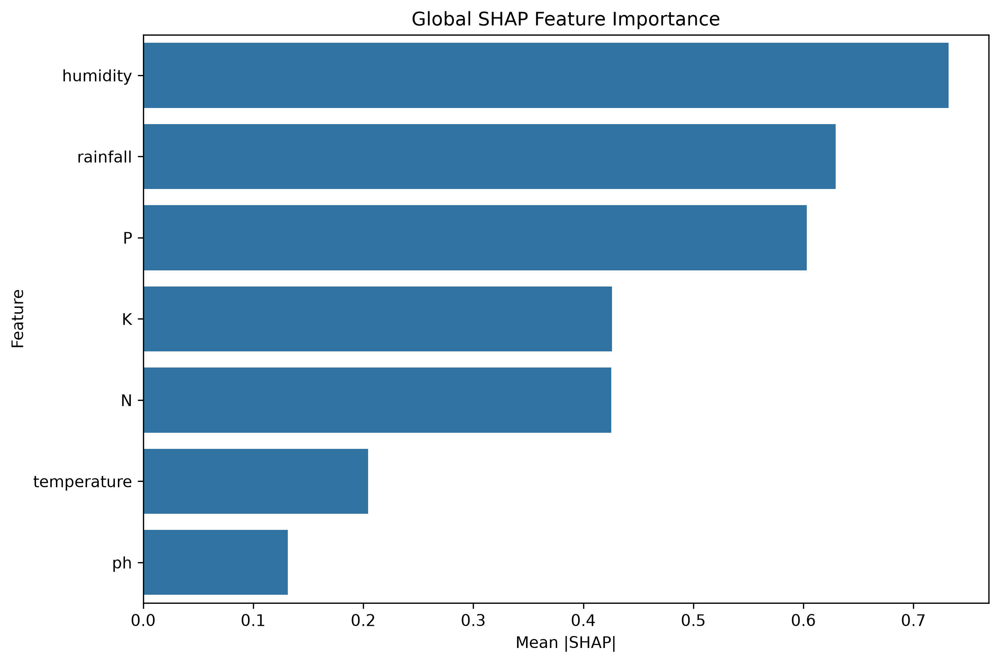
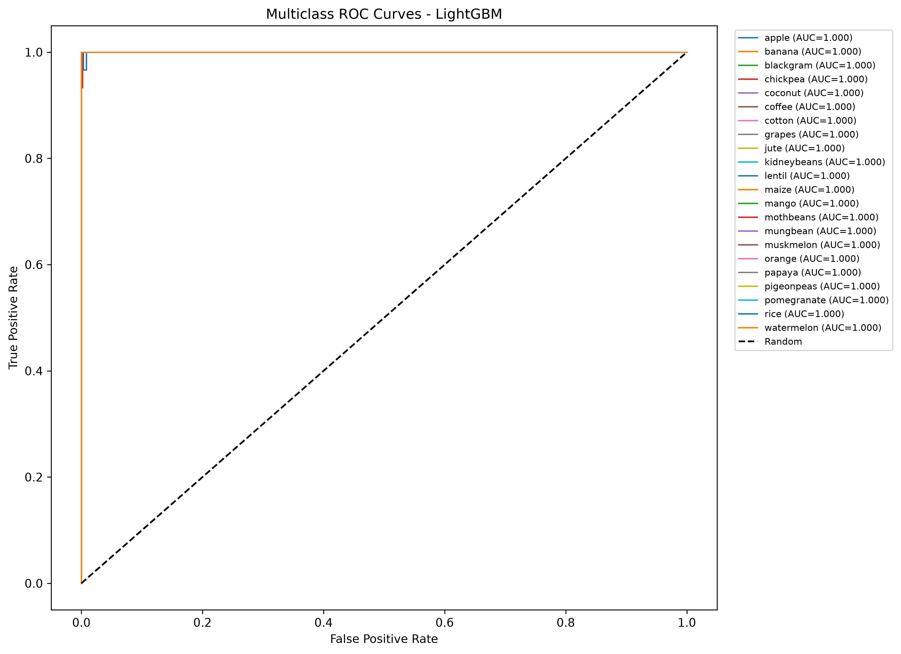

::: {align="center"}
# 🌾 CropCompass

### Crop Recommendation System Using Machine Learning

**Crop Classification · LightGBM · Explainable AI · SHAP · Streamlit**

[](https://www.python.org/)
[](https://streamlit.io/)
[](https://lightgbm.readthedocs.io/)
[](https://scikit-learn.org/)
[](https://shap.readthedocs.io/)

**A data-driven crop advisor that predicts suitable crops from soil
nutrients and environmental conditions, while helping users understand
the model's predictions.**
:::

------------------------------------------------------------------------

## 📌 About the Project

**CropCompass** is a machine learning project that recommends a crop
based on seven soil and climate parameters. It uses a multiclass
**LightGBM classifier** trained on a crop recommendation dataset
containing 2,200 records across 22 crop classes.

The project includes a Jupyter Notebook for data exploration, model
development, evaluation, and explainability, along with a Streamlit
application for interactive predictions and model analysis.

> **Project note:** This repository contains the project source code and
> analysis. It is not itself the deployment repository. The Streamlit
> app can be run locally by following the instructions below.

## ✨ Key Features

-   🌱 **Crop recommendation:** Predict a crop from user-provided soil
    and environmental conditions.
-   🎛️ **Interactive inputs:** Adjust nutrient, temperature, humidity,
    pH, and rainfall values.
-   🏆 **Model comparison:** Compare LightGBM with Decision Tree, Naive
    Bayes, K-Nearest Neighbors, SVM, and Random Forest baselines.
-   🔍 **Explainable AI:** Use SHAP to examine which features influence
    an individual prediction and overall model behaviour.
-   🔀 **What-if analysis:** Explore how changing selected input
    conditions can affect predictions.
-   📊 **Model evaluation:** Review classification metrics, confusion
    matrix, ROC-AUC, and cross-validation results.
-   🧪 **Robustness analysis:** Examine model performance when noise is
    introduced into test inputs.
-   📚 **Crop library:** Explore crop-related profiles derived from the
    dataset.

## 🧭 How It Works

``` text
Crop Recommendation Dataset
            |
            v
 Data Validation and EDA
            |
            v
 Stratified Train-Test Split
            |
            v
 Compare Baseline Models
            |
            v
 Train LightGBM Classifier
            |
            v
 Evaluate Model Performance
            |
            +----------------------+
            |                      |
            v                      v
   Crop Prediction          SHAP Explanations
            |                      |
            +-----------+----------+
                        |
                        v
             Interactive Streamlit App
```

## 🌱 Dataset

The dataset is stored in `Crop_recommendation.csv`. It contains **2,200
rows and 8 columns**, with seven input features and one target label
representing the recommended crop.

  Feature         Description             Unit
  --------------- ----------------------- -------------------------------
  `N`             Nitrogen content        As represented in the dataset
  `P`             Phosphorus content      As represented in the dataset
  `K`             Potassium content       As represented in the dataset
  `temperature`   Temperature             °C
  `humidity`      Relative humidity       \%
  `ph`            Soil pH                 pH value
  `rainfall`      Rainfall                mm
  `label`         Crop class to predict   ---

The dataset contains **22 crop classes**. The application uses the same
seven input features and the `label` target column.

## 🤖 Machine Learning

The notebook and Streamlit app use a stratified 70/30 train-test split
with `random_state=42`.

### Models Compared

  Model                          Approach
  ------------------------------ ----------------------------------------------
  Decision Tree                  Tree-based classification
  Naive Bayes                    Probabilistic classification
  K-Nearest Neighbors (KNN)      Distance-based classification
  Support Vector Machine (SVM)   Margin-based classification
  Random Forest                  Ensemble of decision trees
  **LightGBM**                   Gradient-boosted decision trees; final model

### LightGBM Configuration

  Parameter                                    Value
  ---------------------- ---------------------------
  Objective                Multiclass classification
  Number of estimators                           300
  Learning rate                                 0.05
  Maximum depth                                    8
  Number of leaves                                31
  Random state                                    42

The application computes model metrics when it runs. Refer to the
notebook or the running app for the measured results rather than
assuming a fixed accuracy value.

## 🔍 Explainable AI with SHAP

The project uses **SHAP (SHapley Additive exPlanations)** to help
interpret the LightGBM model.

-   **Global explanation:** Estimates which features are influential
    across a sample of test records.
-   **Local explanation:** Shows how input features contribute toward or
    away from a selected crop prediction.
-   **What-if analysis:** Changes selected input values and observes how
    the model's output responds.

These explanations describe the behaviour of the trained model. They do
not establish that changing a particular soil or climate parameter will
cause the same outcome in real agricultural conditions.

## 📊 Analysis and Visualizations

The `images/` directory contains analysis figures generated for the
project.

### Correlation Heatmap



### Confusion Matrix



### SHAP Feature Importance



### ROC Curves



## 🛠️ Technology Stack

  Category                  Tools
  ------------------------- ------------------------
  Programming language      Python
  Data processing           Pandas, NumPy
  Machine learning          Scikit-learn, LightGBM
  Explainable AI            SHAP
  Visualization             Matplotlib
  Interactive application   Streamlit
  Experimentation           Jupyter Notebook

## 📂 Project Structure

``` text
CropCompass_Crop_Recommendation_System_Using_ML/
│
├── app.py
├── Crop_recommendation.csv
├── crop_recommendation_system.ipynb
├── requirements.txt
├── README.md
├── LICENSE
│
└── images/
    ├── confusion_matrix.png
    ├── correlation_heatmap.png
    ├── feature_importance_shap.png
    ├── roc_curves.png
    └── ...
```

## ⚙️ Run Locally

### 1. Clone the repository

Replace the placeholder URL below with the URL of your GitHub
repository.

``` bash
git clone <YOUR_GITHUB_REPOSITORY_URL>
cd CropCompass_Crop_Recommendation_System_Using_ML
```

### 2. Create and activate a virtual environment

**Windows**

``` bash
python -m venv venv
venv\Scripts\activate
```

**macOS / Linux**

``` bash
python3 -m venv venv
source venv/bin/activate
```

### 3. Install dependencies

``` bash
pip install -r requirements.txt
```

### 4. Start the Streamlit application

``` bash
streamlit run app.py
```

Streamlit will display a local URL in the terminal. Open that URL in
your browser.

### 5. Run the notebook

To explore the analysis and model development, open
`crop_recommendation_system.ipynb` in Jupyter Notebook, JupyterLab, or
Google Colab. Ensure the CSV file is available at the path expected by
the notebook.

## 📦 Dependencies

The main packages are listed in `requirements.txt`:

-   Streamlit
-   Pandas
-   NumPy
-   LightGBM
-   Scikit-learn
-   SHAP
-   Matplotlib

## ⚠️ Limitations

-   Recommendations depend on the quality and coverage of the dataset.
-   The project does not directly use live weather forecasts or
    real-time soil sensor readings.
-   Conditions in the dataset may not represent every region, season, or
    farm.
-   Model confidence is not a guarantee of crop suitability or future
    yield.
-   Predictions should be treated as decision support, not as a
    replacement for local agricultural expertise or soil testing.

## 🔮 Future Improvements

-   Add regional and seasonal information to improve context.
-   Integrate weather APIs and soil sensor data.
-   Explore fertilizer and irrigation recommendations.
-   Add multilingual support for farmers.
-   Evaluate the model on independent, region-specific agricultural
    data.

## 🎯 Project Objective

CropCompass demonstrates an end-to-end machine learning workflow:
preparing agricultural data, comparing classification models, evaluating
performance, explaining predictions with SHAP, and presenting results
through an interactive application.

## 👨‍💻 Author

**Kaustubh Ladda**

------------------------------------------------------------------------

If you find this project useful, consider giving the repository a ⭐ on
GitHub.
